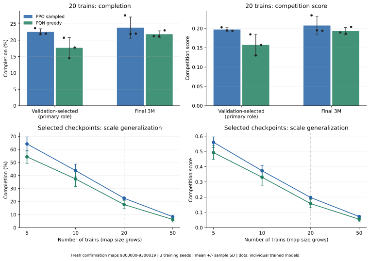
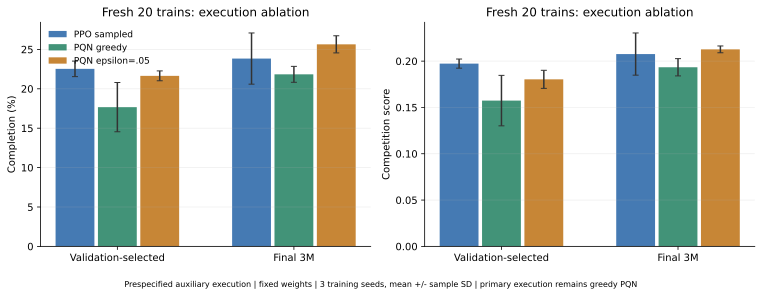

# Value-based railway coordination: matched-budget results

This study compares shared PQN with an episode-based PPO control under the
same 3M environment-tick budget per model and training seeds 42/43/44. All six
models start fresh: 18M formal training ticks total. Training uses 20 trains,
32×32 competition maps, a seed-specific 200-map pool, depth-3 local tree
observations and distance normalization scale20. Reward coefficients are
progress 0.01, first deadlock −0.5 and first arrival +10. No predictor,
malfunctions, communication or departure-cap intervention is used.

PQN uses a shared 64/64 LayerNorm Q network, four synchronous worlds and frozen
Q(lambda) targets (lambda=.65), without replay or a target network. Its epsilon
anneals from 1 to .05 over 1.5M ticks. [Implementation and commands](../../../technical_guide/experiments/value_based_methods.md).

## Independent evaluation

Validation maps 2000–2019 select each model's highest competition-score
checkpoint, with earliest ties. Final 3M checkpoints are a separate role.
All roles/settings were frozen before confirmation maps were generated.

| Cohort | Maps | Episodes |
|---|---|---:|
| Validation pilot | 2000, at 5/20/50 trains | 144 |
| Exposed standard test | 1000–1019, at 5/10/20/50 trains | 3,840 |
| Fresh confirmation | 9300000–9300019, at 5/10/20/50 trains | 3,840 |

PPO has three sampled action seeds plus one greedy case per map; Q has one
greedy case plus three epsilon-.05 cases. Average action repeats within map,
then maps within model, then report mean/sample SD across three training seeds.
The primary comparison is validation-selected, sampled PPO versus greedy PQN
on fresh 20-train maps. Score gives unfinished trains zero and otherwise
averages `1 - arrival_step / episode_limit` over all trains.

| Role and execution, fresh 20 trains | Completion, mean ± SD | Score, mean ± SD |
|---|---:|---:|
| **Selected PPO sampled — primary** | **22.53% ± 0.99 pp** | **0.19730 ± 0.00494** |
| **Selected PQN greedy — primary** | **17.67% ± 3.13 pp** | **0.15738 ± 0.02722** |
| Final 3M PPO sampled | 23.83% ± 3.25 pp | 0.20762 ± 0.02277 |
| Final 3M PQN greedy | 21.83% ± 1.01 pp | 0.19338 ± 0.00933 |

PPO is ahead in the primary comparison by 4.86 completion percentage points
and .03992 score. Final greedy PQN is closer, 2.00 points behind final PPO.
Three training seeds do not establish formal equivalence.



## Prespecified execution ablation

The following changes only Q action selection, with the same frozen weights
and greedy-validation-selected roles. It is a secondary comparison.

| Role | PQN epsilon=.05 completion / score | PPO sampled completion / score |
|---|---:|---:|
| Validation-selected | 21.64% / 0.18033 | 22.53% / 0.19730 |
| Final 3M | 25.64% / 0.21270 | 23.83% / 0.20762 |

Small test-time randomization improves these Q policies. Final epsilon-PQN has
slightly higher means than final PPO; selected epsilon-PQN remains below
selected PPO. These auxiliary results do not replace the primary comparison.



## Learning and cost

| Training measure, mean ± sample SD | PPO | PQN |
|---|---:|---:|
| Normalized validation completion AUC, 0–3M | 18.54% ± 1.44 pp | 14.41% ± 0.39 pp |
| Late adjacent-checkpoint completion change | 2.75 ± 0.18 pp | 4.18 ± 1.17 pp |
| Recorded CPU training hours/run, excluding validation | 45.96 ± 0.44 | 13.05 ± 0.38 |

PPO learns faster per tick and has smaller late checkpoint fluctuations under
these recipes. PQN uses less observed training wall time. Same-seed pairs used
the same respective hosts, but allocation/scheduling/workload differ; the
timing is not a hardware speedup guarantee. Late fluctuation averages absolute
100k-checkpoint changes over 1.5–3M and includes ongoing learning and validation
variability.

These training-log statistics come from the separate frozen training bundle,
SHA-256 `7e7f12966b6fa7645489cbd55ef5793dde82bb825926ff1ba9de9170fb5952cb`.
The evaluation-bundle audit below reconstructs the held-out result table, not
this training-time/AUC table.

On selected fresh 20-train cases, PQN has lower departure (92.83% vs 98.69%) and
lower reward-detector deadlock (47.50% vs 73.17%), together with lower completion.
Lower deadlock alone does not demonstrate better dispatch. Both methods have
low completion at 50 trains; detailed size/role/execution results remain
separate in [summary.csv](summary.csv).

## Data and implementation provenance

- All 7,680 formal episodes and 144 pilot episodes completed. The pilot passed
  12 canonical parity checks. Independent local auditing exactly reproduced
  all three native summaries and recalculated scores for 7,824 episodes from
  166,800 per-train records. Test-time updates/interventions were zero.
- [provenance.json](provenance.json) records seed sets, source identifiers and
  audit counts. The raw archive contains 438 verified files and 10 physical
  selected/final checkpoints. Its SHA-256 is
  `8fcffde9f27b33982127dcdb558cb0275cb114edce851b20d5cb55ca3b6a5b29`.
  Raw logs and weights are distributed separately and remain outside Git.
- Results were produced by the frozen experiment based on upstream
  `f013969`; the contributor integration is based on `b254928`. Integration
  validation checks short-run parameter/optimizer/RNG parity and archived
  policy execution. The full 18M-step training study was not rerun for cleanup.
- This is the team's native Flatland 4.3 protocol without malfunctions, not an
  official historical AIcrowd leaderboard score. Confirmation maps are now
  exposed; future tuning needs a newly reserved confirmation split.

Regenerate the complete recorded result table with the standard repository
audit command (the checksum-pinned raw bundle is a separate input artifact):

```sh
python -m scripts.verify_value_results --bundle /path/to/completed_evaluation_20261105.tar.gz \
  --out results/value_reproduction
```

This checks all 7,824 recorded episodes and writes a byte-identical
`summary.csv`, plus an audit stating that no training or policy inference was
rerun. It verifies the published numbers and frozen model roles, not full
from-scratch reproducibility of the integrated training implementation.
